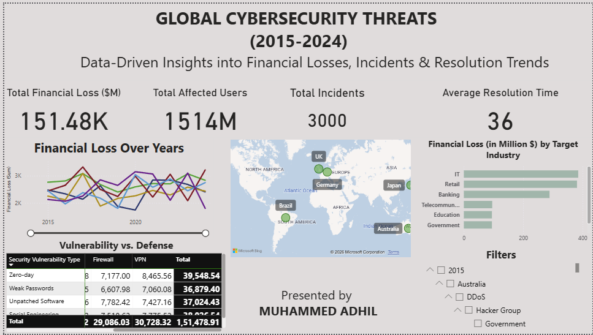

# Global Cybersecurity Threats Analysis Dashboard (2015–2024)

An interactive cybersecurity analytics project built using Power BI to analyze global cyber threats, financial losses, affected users, attack patterns, and incident resolution trends from 2015 to 2024.

## Objective

Analyze global cybersecurity incidents to understand financial impact, identify common vulnerabilities and attack sources, compare threats across countries and industries, and explore incident resolution trends through interactive visualizations.

## Dataset

- **Period:** 2015–2024
- **Coverage:** Global cybersecurity threats
- **Data fields:** Year, country, attack source, security vulnerability type, target industry, financial loss, affected users, incident count, and resolution time.

*Note: Update the field list above to match the actual dataset columns.*

## Tools & Technologies

- **Power BI Desktop** — Interactive dashboards and KPI reporting
- **Microsoft Excel / CSV** — Dataset storage and preparation
- **Data Analytics** — Cybersecurity trend and impact analysis
- **Data Visualization** — Charts, maps, tables, and filters

## Project Workflow

1. **Data Preparation:** Imported the cybersecurity dataset and checked the data fields and formats.
2. **Data Analysis:** Examined financial losses, affected users, attack sources, vulnerabilities, and incident trends.
3. **KPI Development:** Created measures for total financial loss, affected users, total incidents, and average resolution time.
4. **Visualization:** Built line charts, a geographic map, industry comparisons, and a vulnerability-versus-defense matrix.
5. **Dashboard Development:** Combined the visualizations, KPIs, and interactive filters into a Power BI dashboard.

## Dashboard Preview

### Global Cybersecurity Threats Dashboard

## Key Insights

- Total financial loss displayed in the dashboard: approximately 151.48K (verify the unit against the source data).
- Total affected users displayed: 1514M (verify the measure and display formatting).
- Total incidents displayed: 3,000.
- Average resolution time displayed: 36 (specify the time unit, such as hours or days).
- Compare financial losses across target industries.
- Explore changes in financial losses over time.
- Investigate vulnerabilities and defense mechanisms.
- Use geographic and attack-source filters to explore specific threats.

## Dashboard Features

- Total Financial Loss KPI
- Total Affected Users KPI
- Total Incidents KPI
- Average Resolution Time KPI
- Financial Loss Over Years
- Geographic Threat Map
- Financial Loss by Target Industry
- Vulnerability vs. Defense Matrix
- Interactive Filters for year, country, attack source, and other available fields

## Files

- `Global Cybersecurity Threats.pbix` — Power BI dashboard (use the actual filename in your repository).
- `global_cybersecurity_threats.png` — Dashboard screenshot.
- Dataset file — Source cybersecurity data, if included in the repository.

## How to View

1. Download the `.pbix` file from this repository.
2. Open it using Power BI Desktop.
3. Refresh or reconnect the dataset if required.
4. Explore the charts and interactive filters.

## Author

**Muhammed Adhil**

[GitHub Portfolio](https://github.com/adhilpoonakkattayil/data-analyst-portfolio)

