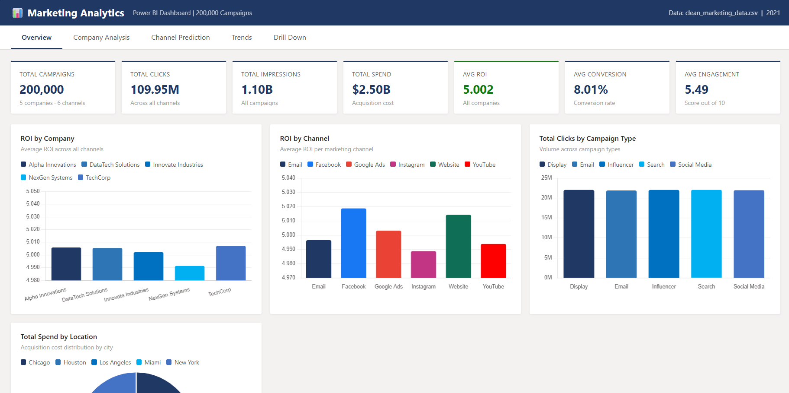
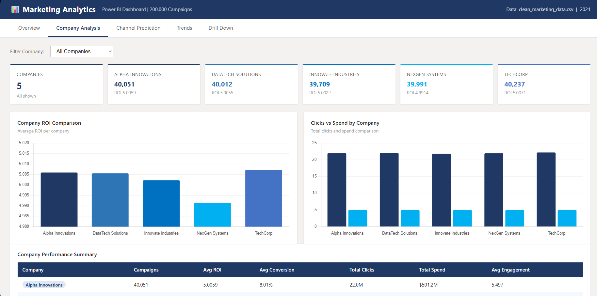
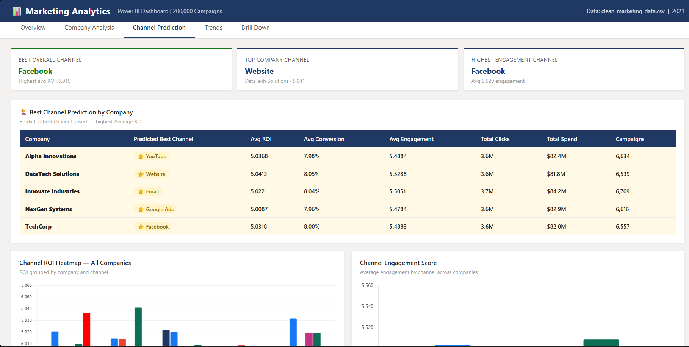
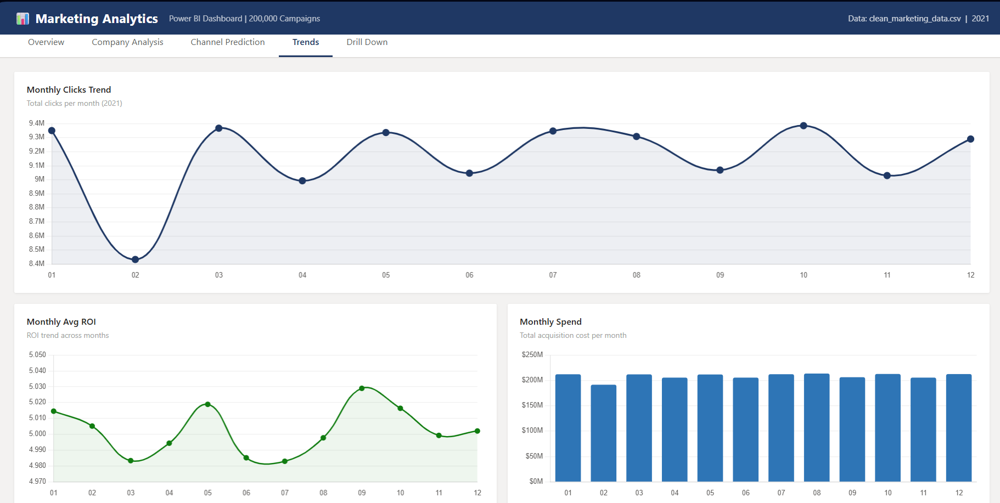
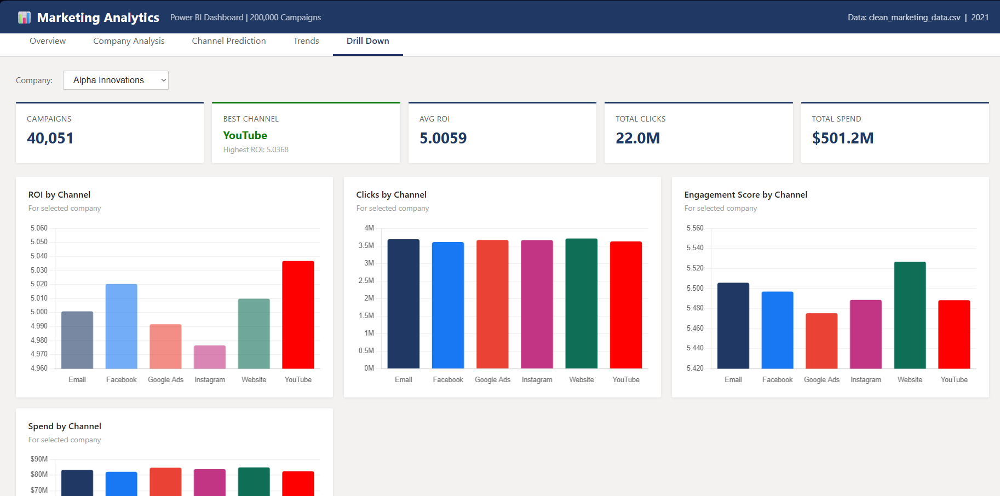

# Marketing Campaign Analytics & Prediction Dashboard

An end-to-end analytics project on 200,000 marketing campaign records. Python was used for cleaning, analysis and predictions, and Power BI for a 5-page interactive dashboard.

## Objective
Understand which campaigns, channels and locations deliver the best return, and predict campaign performance to support budget decisions.

## Dataset
- 200,000 campaign records across 5 companies and 6 channels
- Fields include company, channel, location, campaign type, clicks, impressions, spend, conversion rate, ROI and engagement score

## Tools & Technologies
- **Python** (Pandas, Jupyter Notebook)
- **Power BI** (interactive dashboards, KPI reports)
- **Excel**

## Project Workflow
1. **Data cleaning (Python):** Cleaned the 200,000-record dataset using Pandas
2. **Analysis (Python):** Created summary tables for overview, monthly trend, company, channel, location and campaign analysis
3. **Prediction (Python):** Built ROI forecast and channel, location and campaign prediction outputs
4. **Export:** Saved each analysis as an Excel file
5. **Dashboard (Power BI):** Imported the Excel outputs and built a 5-page dashboard

## Dashboard Preview

### Overview

### Company Analysis

### Channel Prediction

### Trends

### Drill Down

## Key Insights
- 109.95M total clicks and 1.10B impressions with $2.50B total spend
- Average ROI of 5.002, average conversion rate of 8.01%, average engagement score of 5.49/10
- Facebook had the highest average ROI, followed by Website, but differences between channels were small (about 4.98 to 5.02)
- Clicks were spread almost evenly across campaign types (Display, Email, Influencer, Search, Social Media)

## Files
- `Market campign data set.ipynb`: Python cleaning and analysis
- `MARKET.ipynb`: Python analysis and predictions
- `*.xlsx`: Analysis outputs used in Power BI (Overview, Monthly_Trend, Channel_Prediction, Location_Prediction, campaign_Prediction, ROI_Forecast, Company_Channel_Matrix, Company_Channel_Report)
- `Market campign data power bi.pbix`: Power BI dashboard
- Dashboard screenshots (`Screenshot ... .png`)

## Author
**Muhammed Adhil** | [LinkedIn](https://www.linkedin.com/in/adhil-poonakkattayil) | adhilpoonakkattayil@gmail.com
