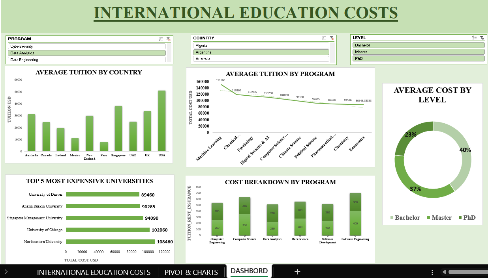

# International Education Costs Analysis | Excel Dashboard

An interactive data analytics project built using Microsoft Excel to explore international education costs across countries, academic programs, universities, and education levels.

## Objective

Analyze international education expenses, compare tuition costs across countries and programs, identify expensive universities, and understand how education costs vary by degree level.

## Dataset

The project uses international education cost data containing information related to:

- Countries
- Academic programs
- Education levels (Bachelor, Master, PhD)
- Universities
- Tuition costs
- Education expense breakdowns

## Tools & Technologies

- **Microsoft Excel** — Data analysis and dashboard development
- **Pivot Tables** — Summarizing and comparing education costs
- **Pivot Charts** — Visualizing trends and cost differences
- **Interactive Slicers** — Filtering by program, country, and education level
- **Data Visualization** — Dashboard design and reporting

## Project Workflow

1. **Data Preparation:** Organized the international education cost dataset in Excel.
2. **Data Analysis:** Compared tuition costs across countries, programs, universities, and education levels.
3. **Pivot Tables:** Summarized the data to identify cost patterns and differences.
4. **Chart Development:** Created charts to compare tuition costs and education expenses.
5. **Dashboard Development:** Combined KPIs and visualizations into an interactive Excel dashboard.
6. **Insights:** Used filters and charts to explore education cost differences.

## Dashboard Preview

### International Education Costs Dashboard

## Dashboard Features

- Average Tuition by Country
- Average Tuition by Program
- Average Cost by Education Level
- Top 5 Most Expensive Universities
- Cost Breakdown by Program
- Program Filter
- Country Filter
- Education Level Filter

## Key Insights

- Compare average tuition costs across countries.
- Identify programs with higher education expenses.
- Compare costs for Bachelor's, Master's, and PhD programs.
- Identify the five most expensive universities in the dataset.
- Explore tuition and other expense components by program.

## Files

- `International_Education_Costs.xlsx` — Excel workbook containing the dataset, Pivot Tables, charts, and interactive dashboard.
- `international_education_costs.png` — Dashboard preview image.

## How to Use

1. Download the Excel workbook from this repository.
2. Open it using Microsoft Excel.
3. Navigate to the Dashboard sheet.
4. Use the slicers to filter by program, country, and education level.
5. Explore the charts to compare international education costs.

## Skills Demonstrated

- Microsoft Excel
- Data Analysis
- Pivot Tables and Pivot Charts
- Interactive Dashboard Development
- Data Visualization
- Business Intelligence and Reporting

## Author

**Muhammed Adhil**

[GitHub Portfolio](https://github.com/adhilpoonakkattayil/data-analyst-portfolio)

